# Complete System Workflows (End-to-End)

All diagrams below reflect the **actual verified implementation** in the repository.

---

## 1. Overall System Architecture & Request Flow

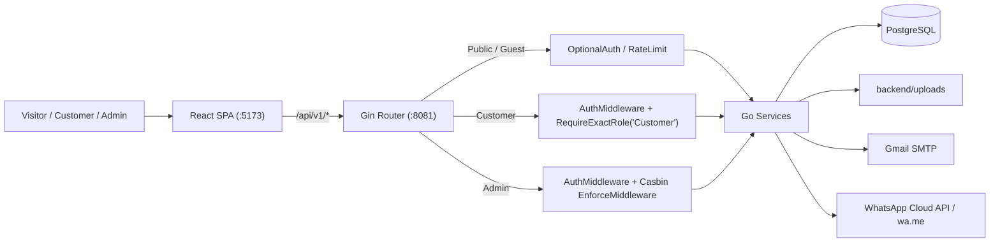

---

## 2. Admin Authentication Workflow

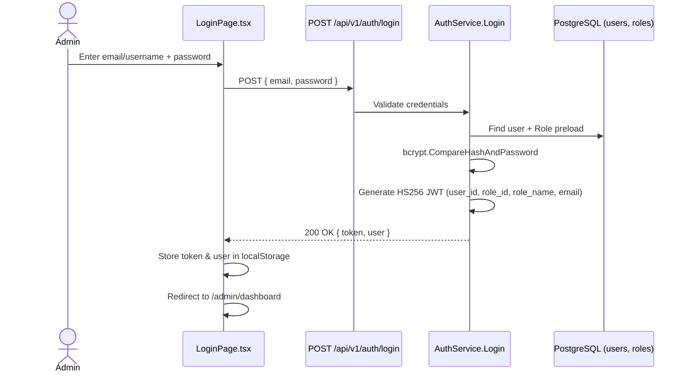

---

## 3. Customer Registration & Email OTP Verification Workflow

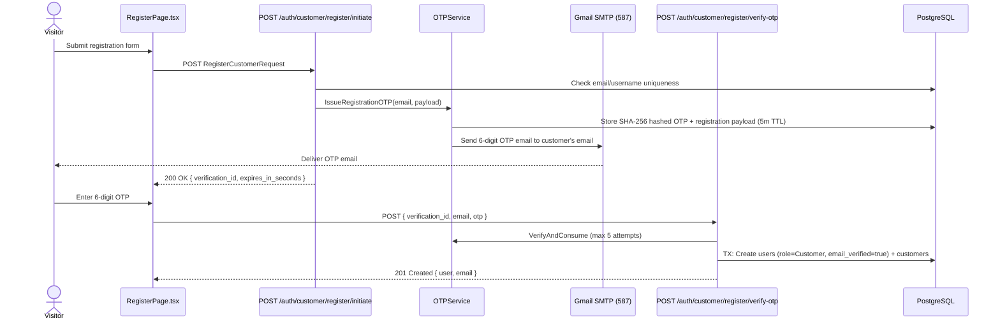

---

## 4. Product Creation & Discount Application Workflow

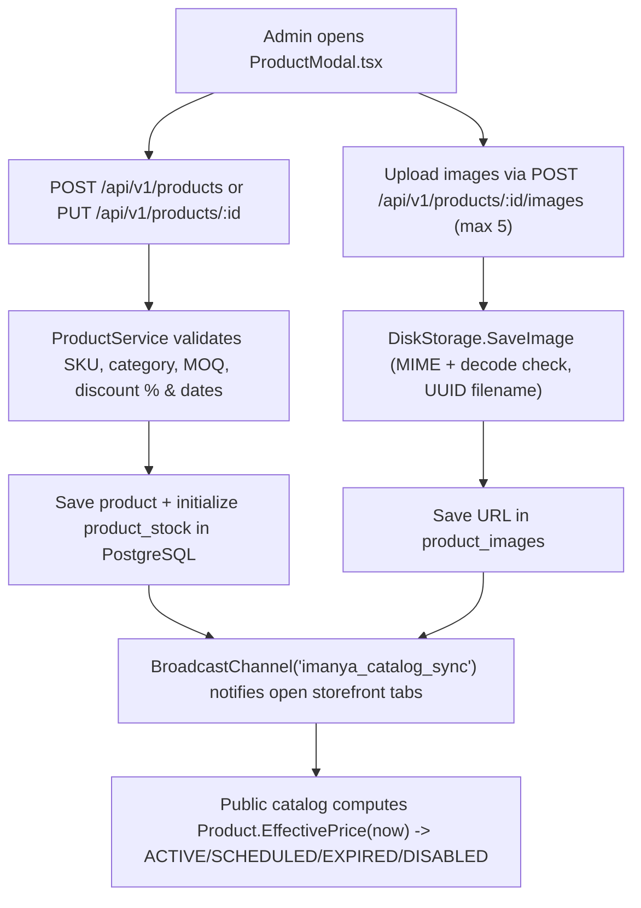

---

## 5. Supplier & Procurement -> Inventory Update Workflow

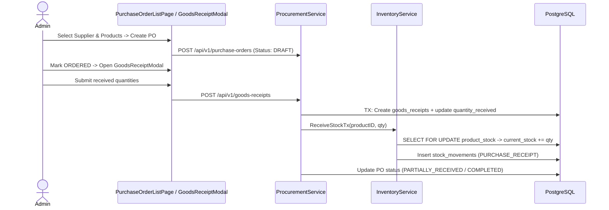

---

## 6. Inventory Adjustment Workflow

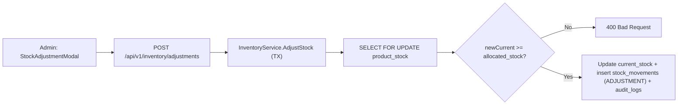

---

## 7. Customer Browsing & Authenticated Shopping Workflow

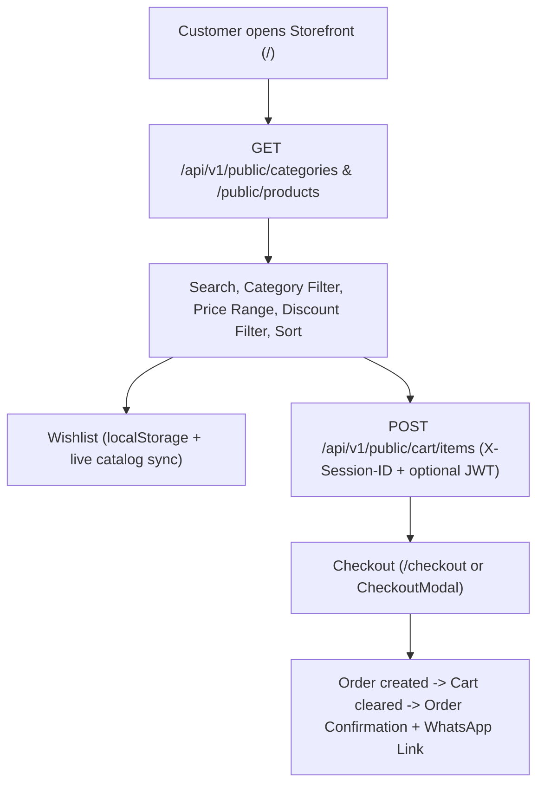

---

## 8. Guest Shopping & Checkout Workflow

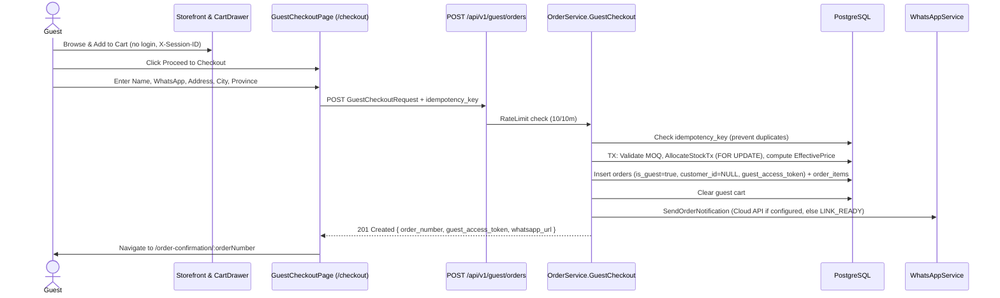

---

## 9. Order Processing & Stock Lifecycle

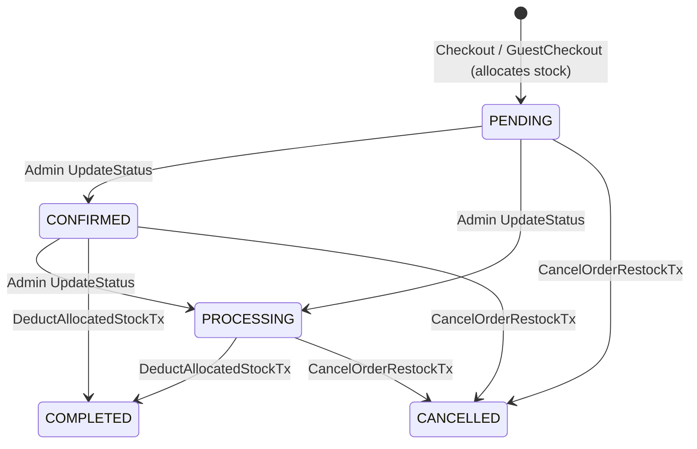

---

## 10. Payment & Receipt Verification Workflow (Current Manual Flow)

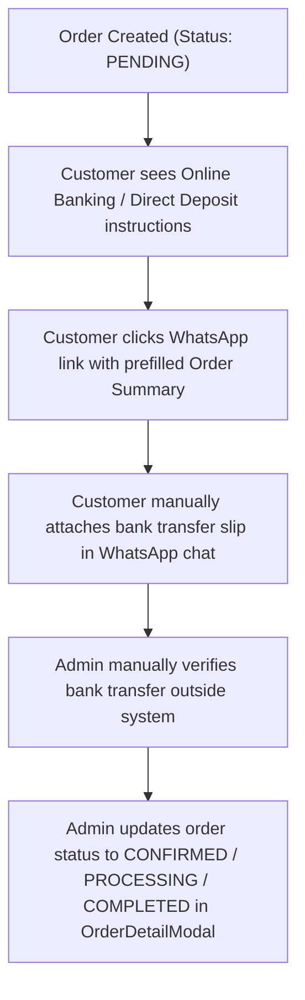
*(Note: Automated in-app payment gateway and in-app receipt image upload are **NOT IMPLEMENTED**.)*

---

## 11. WhatsApp Notification Workflow

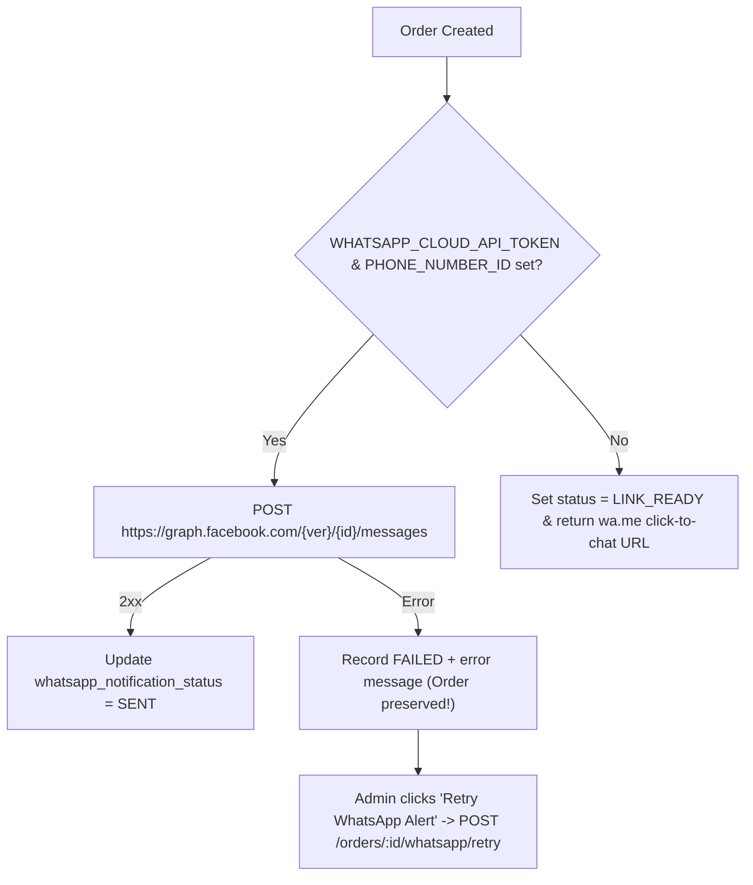

---

## 12. Customer Loyalty Calculation Workflow

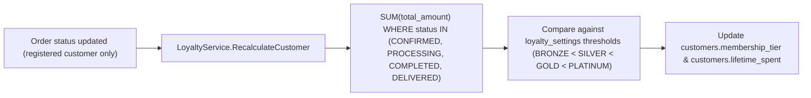

---

## 13. Customer Profile, Photo & Wishlist Workflow

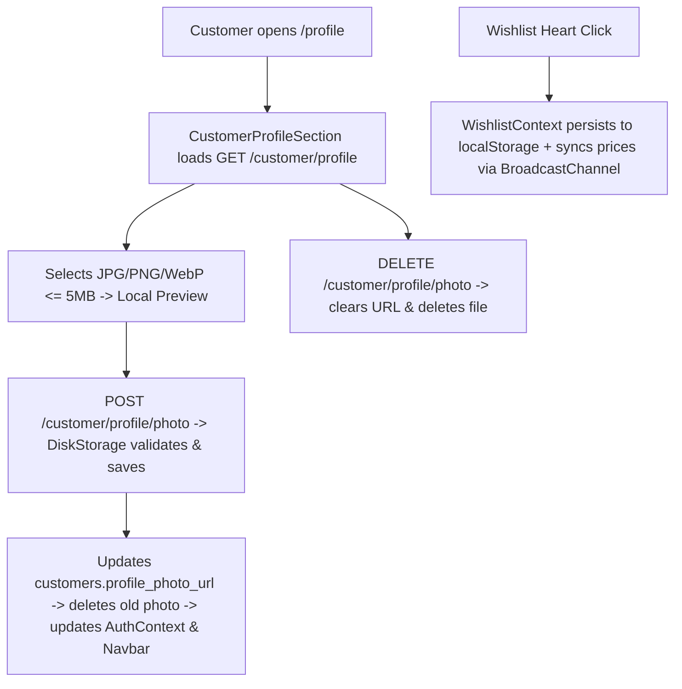

---

## 14. Admin Reporting Workflow

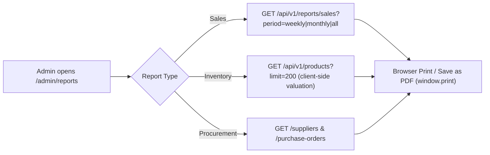
*(Note: Dedicated CSV/Excel export endpoints are **NOT IMPLEMENTED**.)*
