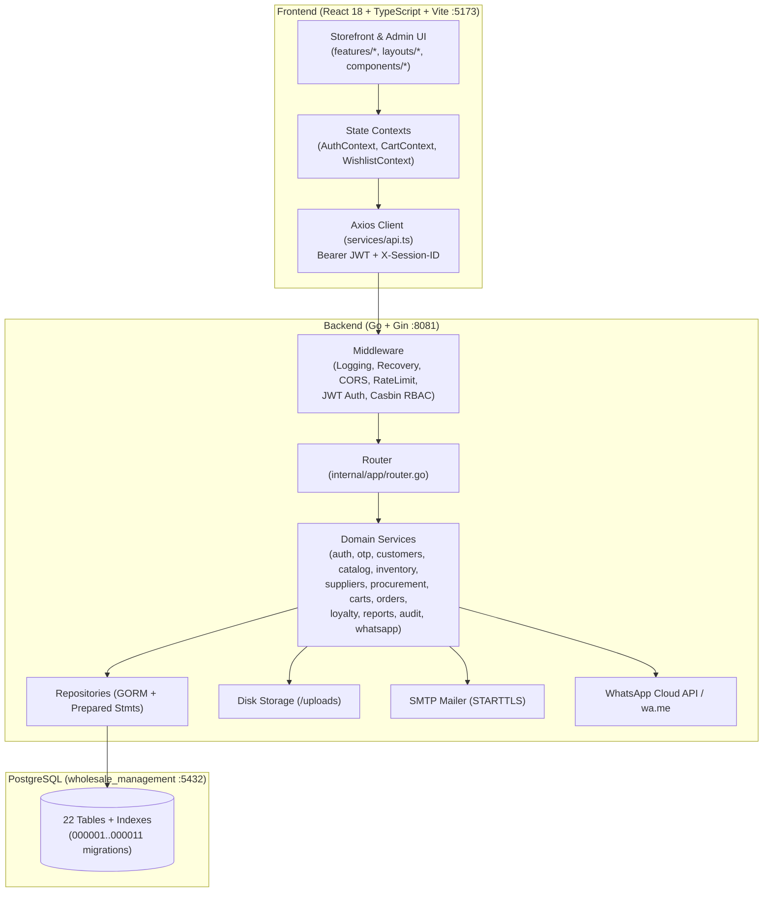

# Project Architecture

## 1. Architectural Pattern
The backend is a **Modular Monolith** structured cleanly by domain under `backend/internal/`, with shared infrastructure under `backend/internal/platform/` and centralized wiring in `backend/internal/app/app.go` and `backend/internal/app/router.go`. Each domain follows a layered **Handler -> Service -> Repository -> Model** pattern with explicit DTOs.

The frontend is a **Feature-Based React SPA** under `frontend/src/features/`, backed by shared Context providers (`AuthContext`, `CartContext`, `WishlistContext`), a centralized Axios client (`frontend/src/services/api.ts`), typed endpoint wrappers (`frontend/src/services/endpoints.ts`), and lazy-loaded routes in `frontend/src/app/App.tsx`.

---

## 2. System Architecture Diagram

---

## 3. Directory Map

### Backend (`backend/`)
- `cmd/api/main.go`: Entry point calling `app.Run()`.
- `cmd/migrate/main.go`: Standalone migration runner executing `migrations/*.up.sql`.
- `internal/app/app.go`: Loads config, initializes Zap logger, connects PostgreSQL, runs migrations, initializes Casbin, DiskStorage, SMTP mailer, all repositories, services, and handlers, and starts the HTTP server.
- `internal/app/router.go`: Configures global middleware, `/uploads` static serving, and `/api/v1` route groups (`/auth`, `/public`, `/guest`, `/customer`, and Casbin-protected admin routes).
- `internal/config/config.go`: Multi-path `.env` loader (`backend/.env` > `.env` > OS env) and SMTP/WhatsApp/DB configuration.
- `internal/platform/`:
  - `database/postgres.go`: GORM PostgreSQL connection pool (`MaxIdle=15`, `MaxOpen=50`, `PrepareStmt=true`) + SQL migration runner.
  - `middleware/`: `auth.go` (JWT + `OptionalAuthMiddleware` + `RequireExactRole`), `casbin.go` (RBAC), `ratelimit.go`, `cors.go`, `logging.go`, `recovery.go`.
  - `storage/disk.go`: Validated local image upload & safe path-traversal-protected deletion.
  - `email/mailer.go` & `templates.go`: Gmail SMTP STARTTLS client + OTP HTML/plain-text MIME builder.
  - `response/response.go`: Standardized JSON `{ success, data, meta, error }` envelope.
- `internal/{audit,auth,carts,catalog,customers,inventory,loyalty,orders,otp,procurement,reports,suppliers,users,whatsapp}/`: Domain modules.

### Frontend (`frontend/src/`)
- `app/App.tsx`: `BrowserRouter` routes wrapped in `AuthProvider`, `CartProvider`, `WishlistProvider`, and `Suspense` lazy loading.
- `layouts/`: `StorefrontLayout.tsx`, `AdminLayout.tsx`, `AuthLayout.tsx`.
- `components/`: `ui/` (`Avatar`, `Badge`, `Button`, `Card`, `Input`, `MembershipBadge`, `MembershipProgressBar`, `Modal`, `Spinner`) and `shared/` (`Navbar`, `Sidebar`, `AdminHeader`, `WhatsAppWidget`).
- `features/`: `auth`, `cart`, `catalog`, `customer`, `customers`, `dashboard`, `inventory`, `orders`, `procurement`, `reports`, `storefront`, `suppliers`, `users`, `wishlist`.
- `services/`: `api.ts`, `endpoints.ts`.
- `utils/`: `catalogSync.ts` (`BroadcastChannel`), `formatters.ts`, `whatsapp.ts`.
